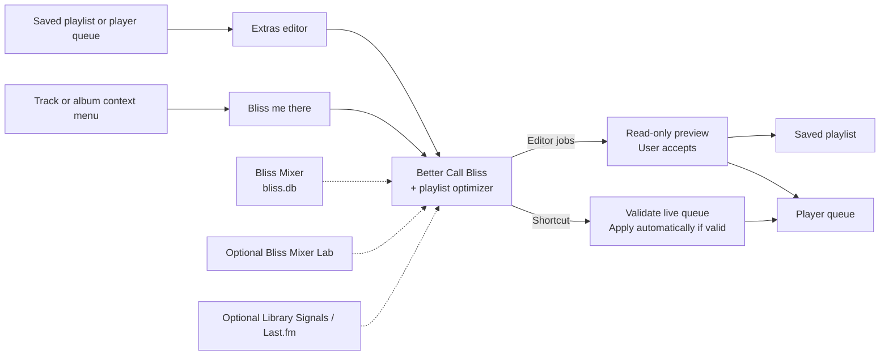

# Better Call Bliss

<p align="center">
  
</p>

**Make your playlists flow.**

Have a playlist you love, but wish the songs flowed together better? **Better Call Bliss** uses acoustic analysis provided by [Bliss Mixer](https://github.com/CDrummond/lms-blissmixer) to reorder tracks, add suitable tracks between them, or extend a short playlist into a longer listening session.

It can also optimize your current player queue or build a musical route to a particular track or album. **Playlist and queue editing jobs show a read-only preview before you apply the result.** The three **Bliss me there...** context-menu shortcuts run in the background and apply a successful route automatically after checking the live player queue. Your audio files and the Bliss analysis database are never modified.

## What can I do with it?

### Make an existing playlist flow better

*"I like all the songs in this playlist, but the changes from one track to the next feel abrupt."*

Let Better Call Bliss reorder the tracks to find smoother transitions, while respecting your track, artist, and album repeat rules.

### Keep my playlist order, but smooth out the gaps

*"I carefully chose the order of my songs. I only want help getting from one to the next."*

Keep the original sequence and insert suitable bridging tracks between the existing entries. You can let the plugin decide where bridges are useful or request a fixed number per gap.

### Turn a short playlist into a longer listening session

*"I have a great 30-minute playlist, but I want music for the whole evening."*

Add a specific number of tracks, grow to a target track count, or double the playlist length while following the sound and constraints of the original selection.

### Take a musical journey to a track or album

*"I'm listening to something now, and I want to arrive at this other song—or even a whole album—without an abrupt jump."*

The track and album context menus offer three shortcuts:

- **Bliss me there...** — Keep the currently playing song and replace the upcoming queue with a route to your selected track or album.
- **Bliss me there... and back again!** — Take a detour to the selected track or album, then return to your original upcoming queue.
- **Bliss me there... when we're through!** — Leave the current queue in place and append a route to your destination at the end.

An album destination includes its local audio tracks in disc and track order. Unlike playlist and queue editor jobs, these shortcuts **do not ask you to accept a preview**: they apply the completed route automatically, but only after verifying that the captured player-queue anchors still match. If the route fails or the queue has changed in an incompatible way, no queue changes are made.

### Improve what's coming up next

*"The current song is fine, but I'd like a better sequence for the rest of the queue."*

Use a snapshot of your player queue, work with the upcoming tracks, and send a new sequence back to the player without interrupting the current track when you use **Replace upcoming tracks**.

## Key features

- **Multiple playlist strategies:** Reorder, preserve source order, add bridges, add exact counts, extend a list, or fill source gaps with an exact number of bridging tracks.
- **Playlist and queue inputs:** Use saved playlists, full player queues, upcoming tracks only, or the current-plus-upcoming queue segment.
- **Preview for editor jobs:** Inspect the proposed track order, additions, and diagnostic information before committing to a result. **Bliss me there...** shortcuts instead apply valid routes automatically after checking the live queue.
- **Flexible destinations:** Create a verified copy of a playlist, overwrite the source where available, or replace, append to, or insert tracks into a player's queue. Optional start playback is supported.
- **Repeat rules remain hard constraints:** The optimizer checks track, artist, and album spacing rather than treating them as soft preferences.
- **Configurable search:** Choose Fast, Balanced, or Thorough searches, plus Normal or Cautious automatic bridge handling.
- **Optional personalized and contextual guidance:** Use a learned matrix from Bliss Mixer Lab or enable separate guidance providers for listening history or Last.fm information.

See [Playlist optimization modes and options](ALGORITHMS.md) for the algorithms, options, supported combinations, and the distinction between implemented and planned modes.

## How it fits into the Bliss ecosystem

Better Call Bliss complements [Bliss Mixer](https://github.com/CDrummond/lms-blissmixer); it does **not** replace its **Create bliss mix** action. Bliss Mixer creates immediate mixes from track, artist, album, or genre context. The **Extras editor** provides previewable transformations of saved playlists and player queues, with explicit control over the result and its destination. The **Bliss me there...** shortcuts instead apply successful background routes to a live queue automatically after validation.

| Component | What it contributes | Required? |
| --- | --- | --- |
| **[Bliss Mixer](https://github.com/CDrummond/lms-blissmixer)** | Acoustic library analysis (`bliss.db`) and base Bliss preferences | **Yes** |
| **Better Call Bliss** | Playlist/queue user interface, jobs, preview, and output | This plugin |
| [Bliss Mixer Lab](https://github.com/chrober/lms-blissmixer-lab) | Optional learned matrix and learned-blend preference | No |
| [Library Signals](https://github.com/chrober/lms-guidance-library-signals) | Optional preferences based on play count, last played, and library age | No |
| [Last.fm Guidance](https://github.com/chrober/lms-guidance-lastfm) | Optional related-track and related-artist information | No |

The separate **Bliss Guidance** plugins are passive providers: installing them alone does not change any playlist or queue. Better Call Bliss discovers compatible providers automatically but keeps each one disabled until you explicitly enable it. They can influence how an already Bliss-eligible candidate set is ranked; Bliss acoustic similarity and hard constraints still apply.

## Requirements

- **Lyrion Music Server:** Developed and tested with **Lyrion 9.1**. Older versions may also work, but have not been tested.
- A compatible [Bliss Mixer](https://github.com/CDrummond/lms-blissmixer) installation, enabled and configured.
- A completed Bliss library analysis, with readable `bliss.db` in the LMS preferences directory.
- A configured local music folder whose tracks match that analysis.
- A compatible native `bliss-playlist-optimizer` binary. Official plugin-feed packages provide binaries for Windows, macOS, x86_64 Linux, ARM64 Linux, and ARMHF Linux.
- **Optional:** Bliss Mixer Lab and/or compatible Bliss Guidance providers, installed separately.

Without an enabled Bliss Mixer Lab and its valid learned matrix, Better Call Bliss can still operate: its Adaptive behavior falls back to Bliss Mixer-style use of variance for multi-track contexts and configured Static weights for one-track contexts. See [Is a learned matrix optional?](ALGORITHMS.md#is-a-learned-matrix-optional).

## Installation

1. Install and enable [Bliss Mixer](https://github.com/CDrummond/lms-blissmixer) and complete its library analysis.
2. Open **LMS Settings > Plugins** and add the following additional plugin repository:

   ```text
   https://raw.githubusercontent.com/chrober/lms-plugins/main/repo.xml
   ```

3. Install **Better Call Bliss** through the plugin manager and restart LMS when requested.
4. Open **Extras > Better Call Bliss**.

The repository selects a package for your server platform, including the native optimizer. Updates can be installed through the same LMS plugin manager.

## Getting started

1. Open **Extras > Better Call Bliss**.
2. Select a **saved playlist** or a **player queue snapshot**.
3. Choose whether to preserve the existing track order or optimize it, and whether to add any tracks.
4. Adjust the optional repeat and search settings, then run **Preview**.
5. Review the proposed order, added tracks, and diagnostics.
6. Accept the result by **creating a copy**, **overwriting the original playlist** when available, or **sending it to a player queue**.

When a live player is both source and destination, **Replace upcoming tracks** leaves the currently playing song in place and changes only the upcoming part. Unsupported option combinations are rejected or clearly shown as unavailable.

To use the destination shortcuts, select a local track or album and choose one of the **Bliss me there...** menu entries described above. These are background actions, not read-only editor previews; a successful route is applied automatically after live queue validation.

## Configuration and limitations

- **Preview for editor jobs, automatic application for shortcuts:** Playlist and queue editor jobs require explicit acceptance of a read-only preview. **Bliss me there...** actions instead apply completed routes automatically, provided the relevant live queue anchors still match.
- **No source-file edits:** Audio files and `bliss.db` are not modified.
- **Hard constraints matter:** Your repeat rules can limit which routes and additions are feasible.
- **Optional providers must be enabled:** Provider-specific configuration, acquisition requirements, and limitations are explained in each provider's repository.
- **Available vs. planned features:** Some disabled controls in the user interface describe planned modes; they are not implemented functionality. Check [UX status](docs/UX_STATUS.md) for the full feature matrix.

## Technical details

### Architecture

The Lyrion plugin owns settings, user interface, background jobs, result review, playlist persistence, queue output, and discovery of optional guidance providers. **The editor and the three context-menu shortcuts share the same optimizer, but have different application workflows:** editor results require explicit preview acceptance; context-menu routes are applied automatically only after validation of the captured live queue anchors. CPU-intensive acoustic scoring and route search are delegated to the Rust engine [`bliss-playlist-optimizer`](https://github.com/chrober/bliss-playlist-optimizer). Providers may acquire bounded data during preparation; **route scoring itself is network-free**.



See [Guidance data flow](docs/GUIDANCE_DATA_FLOW.md) for the host/optimizer/provider flow. The common interfaces are described by [`bliss-playlist-guidance-spi`](https://github.com/chrober/bliss-playlist-guidance-spi) and [`lms-bliss-guidance-provider-kit`](https://github.com/chrober/lms-bliss-guidance-provider-kit).

### Repository contents

- `BetterCallBliss/`: installable LMS plugin source, settings, web templates, translations, icons, and `install.xml`.
- `BetterCallBliss/Bin/SOURCE.md`: optimizer release pin and binary packaging contract. Native executables are copied into release packages, not committed to this source repository.
- `tests/`: Perl and Python regression checks for plugin integration, request JSON typing, optional guidance, per-job options, metadata, and platform-specific publishing.
- `docs/` and `ALGORITHMS.md`: user/technical documentation and feature status.

### Releases and publishing

`.github/workflows/release.yml` validates the plugin, downloads the pinned native optimizer for Windows, macOS, x86_64 Linux, ARM64 Linux, and ARMHF Linux, verifies SHA-256 checksums, and creates separate platform-specific packages and checksums. It confirms that each archive contains only the expected platform family, then publishes a GitHub Release and updates the matching entries in the [`lms-plugins`](https://github.com/chrober/lms-plugins) feed unless disabled.

Cross-repository feed updates use the `LMS_PLUGINS_TOKEN` secret with contents-write access to `chrober/lms-plugins`. A manual `dry_run=true` validates and packages releases for inspection without publishing or changing the feed.

## License and credits

Better Call Bliss builds on and credits Craig Drummond's work on [Bliss Mixer](https://github.com/CDrummond/lms-blissmixer). Licensed under **GPL-3.0-only**. See [LICENSE](LICENSE).
